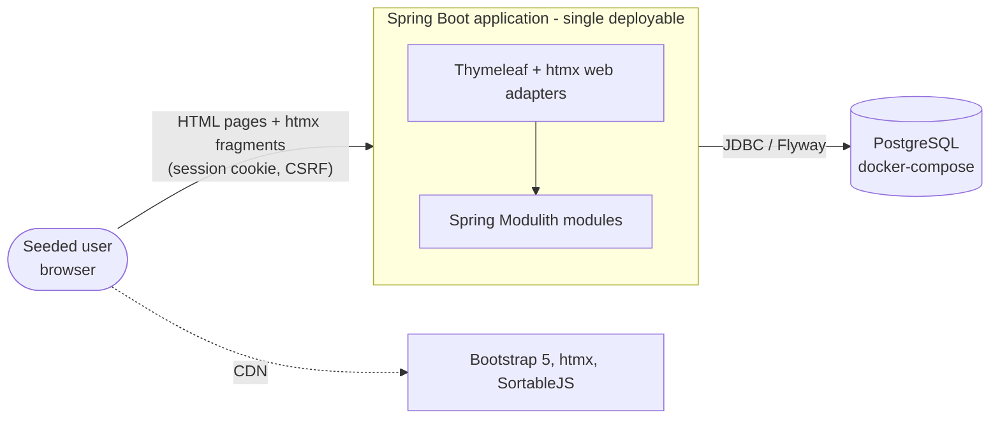
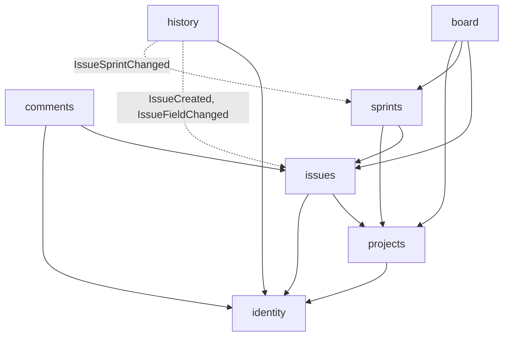
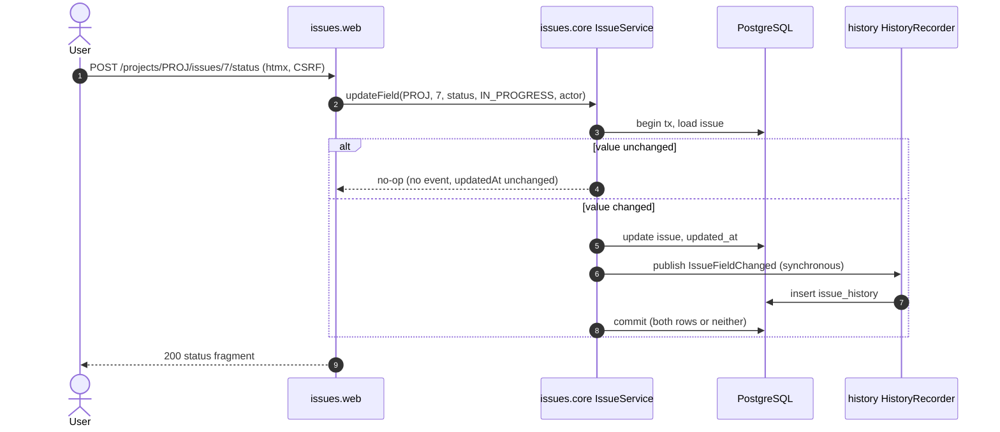
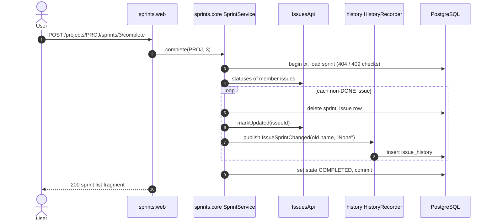

# Architecture Reference

This document describes how the Jira clone MVP is structured. Behaviour is owned by the specs in [`specs/`](../specs); coding rules are in [`AGENTS.md`](../AGENTS.md); the data model is in [`database.md`](./database.md). This is a target architecture: until the skeleton MR lands, no code exists.

## 1. System context



| Concern | Choice |
| --- | --- |
| Language / build | Java 25, Maven (wrapper) |
| Framework | Spring Boot, Spring MVC, Spring Security, Spring Data JPA, Spring Modulith |
| UI | Server-rendered Thymeleaf; htmx for fragments; Bootstrap 5 and SortableJS from CDN; no Node build |
| Database | PostgreSQL, schema owned by Flyway, `ddl-auto=validate` |
| Runtime | Local only: `docker compose` for Postgres, app run with Maven |
| Tests | JUnit Jupiter, AssertJ, MockMvc, Testcontainers (no H2), `ApplicationModules.verify()` |

## 2. Modules

The application is a modular monolith. Each bounded context is a top-level package under the base package (provisionally `com.jiraclone`; fixed in the skeleton MR).

| Module | Owns (tables) | Public API (root package) | Publishes | Spec |
| --- | --- | --- | --- | --- |
| `identity` | `app_user` | `IdentityApi`: current user, find user, list users, display names | — | [authentication](../specs/authentication-spec.md) |
| `projects` | `project` | `ProjectsApi`: find project by key | — | [projects](../specs/projects-spec.md) |
| `issues` | `issue`, `issue_counter` | `IssuesApi`: find issue by key/number, list by ids, change status, mark updated | `IssueCreated`, `IssueFieldChanged` | [issues](../specs/issues-spec.md) |
| `board` | — | — (web only) | — | [board](../specs/board-spec.md) |
| `comments` | `comment` | — (web only) | — | [comments](../specs/comments-spec.md) |
| `history` | `issue_history` | — (web + listeners) | — | [activity-history](../specs/activity-history-spec.md) |
| `sprints` | `sprint`, `sprint_issue` | `SprintsApi`: issue ids in a sprint / in any sprint, sprint of an issue | `IssueSprintChanged` | [sprints](../specs/sprints-spec.md) |
| `common` | — | Shared layout, `@ControllerAdvice` (404/422), htmx helpers, security config | — | — |

### Allowed dependencies

Arrows read "depends on". Solid = synchronous `*Api` call; dashed = listens to events. Every module may use `common`. The graph is acyclic; `ApplicationModules.verify()` enforces it.



Rules:

- A module only imports another module's root package (its `*Api` and events). Never `core/`, `web/` or `config/`.
- A module writes only its own tables. Cross-module state changes go through the owner's API (`IssuesApi.changeStatus`, `IssuesApi.markUpdated`) or events.
- Events carry primitive ids and already-resolved display strings, never entities.
- Database foreign keys may cross modules (single schema, integrity guaranteed by Postgres). JPA entities reference another module's rows by `Long` id only — no cross-module `@ManyToOne`.

## 3. Package layout

```text
com.jiraclone
├── JiraCloneApplication.java
├── common/                     layout, error handling, htmx helpers, SecurityConfig
├── identity/
│   ├── IdentityApi.java
│   ├── UserRef.java            (record: id, username, displayName)
│   ├── core/                   AppUser entity, repository, UserDetailsService, IdentityApi impl
│   └── web/                    LoginController
├── issues/
│   ├── IssuesApi.java
│   ├── IssueCreated.java, IssueFieldChanged.java
│   ├── core/                   Issue entity, IssueCounter, IssueService (create, update field)
│   └── web/                    list/detail/create/edit controllers, form DTOs
├── board/web/                  BoardController
├── comments/{core,web}/
├── history/{core,web}/         HistoryRecorder (@EventListener), HistoryController
├── sprints/
│   ├── SprintsApi.java, IssueSprintChanged.java
│   └── {core,web}/
└── projects/{ProjectsApi.java, core/, web/}
```

Templates follow the same ownership: `templates/<module>/...`; shared layout and error pages under `templates/common/`.

## 4. Web layer and htmx conventions

- Every navigable URL renders a complete page on a plain `GET`. When `HX-Request: true`, the same controller returns only the fragment named by the target (for example the issue list body).
- Mutations are `POST` with a CSRF token. The layout puts the token in `hx-headers` so every htmx request carries it.
- Validation failures return `422` with the re-rendered form or fragment. htmx is configured to swap `422` responses.
- Not-found returns `404` through the shared `@ControllerAdvice`.
- Unauthenticated htmx requests get `401` with `HX-Redirect: /login`; normal requests get `302` (see the authentication spec).
- **Issue detail page composition:** the issue page is owned by `issues`. The comments, history and sprint picker sections are separate fragments owned by their modules and loaded with `hx-get` + `hx-trigger="load"` from that module's own URL. This keeps `issues` free of dependencies on `comments`, `history` and `sprints` (which depend on it). Without JavaScript those sections do not load; this is an accepted MVP limitation.
- Custom JavaScript is limited to the SortableJS glue on the board.

## 5. Key flows

### Field edit with history (same transaction)



The board move (`POST /projects/{key}/board/move`) calls `IssuesApi.changeStatus`, which uses the same path, so it records the same history entry.

### Sprint completion



## 6. Architecture decisions

| # | Decision | Why |
| --- | --- | --- |
| AD-1 | Modular monolith with Spring Modulith, one deployable, one schema | MVP size; module boundaries checked by tests rather than by network calls |
| AD-2 | History is written by a **synchronous** `@EventListener` in the publisher's transaction | The history spec requires change and entry to be atomic. `@ApplicationModuleListener` runs after commit and cannot give that. This is a documented exception to the AGENTS.md preference; there is no Event Publication Registry table |
| AD-3 | Events carry resolved display values (assignee display name, sprint name) | History stores names as they were at write time and stays dependent only on event contracts |
| AD-4 | Sprint membership lives in `sprint_issue`, owned by `sprints` | Avoids `sprints` writing `issue.sprint_id`, which `issues` owns |
| AD-5 | Issue numbering uses `issue_counter`, owned by `issues`, created lazily by upsert | Avoids `issues` writing to `project`; the upsert is atomic and gap-free |
| AD-6 | Cross-module references are database foreign keys but plain ids in Java | Referential integrity without coupling entity graphs across modules |
| AD-7 | Issue detail sections are loaded as fragments from their owning modules | Keeps the dependency graph acyclic |
| AD-8 | Sessions in memory; no Spring Session table | Local-only MVP; restart logs users out, which no spec forbids |
| AD-9 | Concurrency rules (unique project key, one active sprint, issue numbering) are enforced by database constraints and mapped to `422`/`409` | Correct under concurrent requests without application locks |

## 7. Testing strategy

| Level | Tooling | Scope |
| --- | --- | --- |
| Architecture | `ApplicationModules.of(JiraCloneApplication.class).verify()` | Module boundaries and acyclic dependencies |
| Module integration | `@ApplicationModuleTest` or `@SpringBootTest` + Testcontainers Postgres | Services, constraints, event listener atomicity |
| Web | MockMvc with security and CSRF enabled | Status codes, fragments vs full pages, `HX-*` headers, escaping |
| Concurrency | Parallel requests against Testcontainers | PRJ-6, ISS-5, SPR-5 |
| Manual | Browser | Drag-and-drop, htmx swaps |
