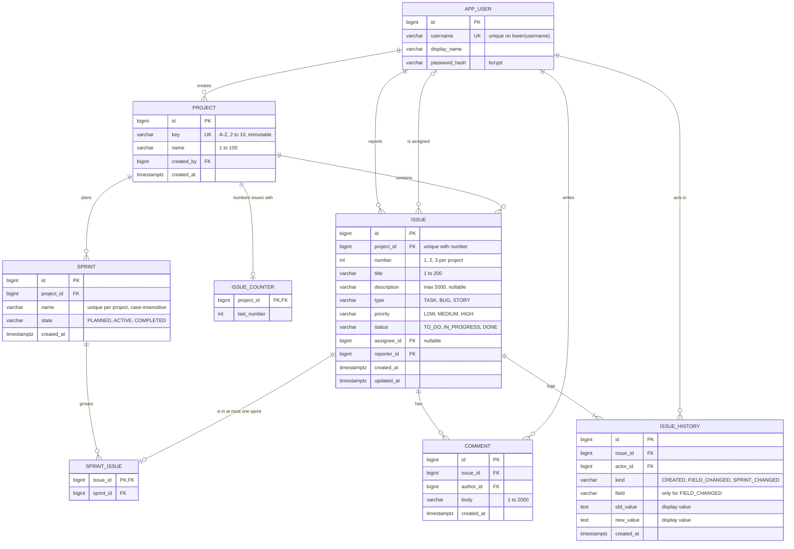

# Data Model and ER Diagram

This is the data model for the Jira clone MVP. It is derived from the specs in [`specs/`](../specs) and follows the module ownership in [`architecture.md`](./architecture.md). Database: PostgreSQL, schema managed by Flyway.

## 1. Entities

| Entity (table) | Owning module | Identifier | Description |
| --- | --- | --- | --- |
| User (`app_user`) | identity | `id`; natural key `lower(username)` | Seeded person who can log in |
| Project (`project`) | projects | `id`; natural key `key` | Container of issues, e.g. `PROJ` |
| Issue counter (`issue_counter`) | issues | `project_id` | Next issue number for a project |
| Issue (`issue`) | issues | `id`; natural key (`project_id`, `number`), shown as `PROJ-7` | Unit of work |
| Sprint (`sprint`) | sprints | `id`; natural key (`project_id`, `lower(name)`) | Named grouping of issues in a project |
| Sprint membership (`sprint_issue`) | sprints | `issue_id` | Which sprint an issue is in |
| Comment (`comment`) | comments | `id` | Plain-text note on an issue |
| History entry (`issue_history`) | history | `id` | Append-only change log entry for an issue |

## 2. Attributes

### `app_user`

| Attribute | Type | Null | Rule |
| --- | --- | --- | --- |
| `id` | `bigint` identity | no | PK |
| `username` | `varchar(50)` | no | Unique case-insensitively (`UNIQUE (lower(username))`) — AUTH-8 |
| `display_name` | `varchar(100)` | no | Shown in pickers, comments, history |
| `password_hash` | `varchar(100)` | no | bcrypt; never plain text — AUTH-7. Becomes nullable if an external IdP is adopted (architecture §7) |

### `project`

| Attribute | Type | Null | Rule |
| --- | --- | --- | --- |
| `id` | `bigint` identity | no | PK |
| `key` | `varchar(10)` | no | `UNIQUE`; `CHECK (key ~ '^[A-Z]{2,10}$')`; immutable — PRJ-3, PRJ-5 |
| `name` | `varchar(100)` | no | 1–100 chars after trim — PRJ-4 |
| `created_by` | `bigint` | no | FK → `app_user.id` |
| `created_at` | `timestamptz` | no | Set by system |

### `issue_counter`

| Attribute | Type | Null | Rule |
| --- | --- | --- | --- |
| `project_id` | `bigint` | no | PK, FK → `project.id` |
| `last_number` | `integer` | no | Highest number allocated; incremented atomically by upsert — ISS-5 |

### `issue`

| Attribute | Type | Null | Rule |
| --- | --- | --- | --- |
| `id` | `bigint` identity | no | PK (internal; URLs use key + number) |
| `project_id` | `bigint` | no | FK → `project.id` |
| `number` | `integer` | no | `UNIQUE (project_id, number)`; ≥ 1 — ISS-1, ISS-6 |
| `title` | `varchar(200)` | no | 1–200 chars after trim — ISS-3 |
| `description` | `varchar(5000)` | yes | ≤ 5000 chars — ISS-4 |
| `type` | `varchar(20)` | no | `CHECK IN ('TASK','BUG','STORY')`, default `TASK` |
| `priority` | `varchar(20)` | no | `CHECK IN ('LOW','MEDIUM','HIGH')`, default `MEDIUM` |
| `status` | `varchar(20)` | no | `CHECK IN ('TO_DO','IN_PROGRESS','DONE')`, default `TO_DO` |
| `assignee_id` | `bigint` | yes | FK → `app_user.id`; null = unassigned |
| `reporter_id` | `bigint` | no | FK → `app_user.id`; immutable |
| `created_at` | `timestamptz` | no | Set by system |
| `updated_at` | `timestamptz` | no | Changes only when a value changes — ISS-17 |

### `sprint`

| Attribute | Type | Null | Rule |
| --- | --- | --- | --- |
| `id` | `bigint` identity | no | PK |
| `project_id` | `bigint` | no | FK → `project.id` |
| `name` | `varchar(100)` | no | `UNIQUE (project_id, lower(name))` — SPR-2 |
| `state` | `varchar(20)` | no | `CHECK IN ('PLANNED','ACTIVE','COMPLETED')`; partial unique index `(project_id) WHERE state = 'ACTIVE'` — SPR-4, SPR-5 |
| `created_at` | `timestamptz` | no | Set by system |

### `sprint_issue`

| Attribute | Type | Null | Rule |
| --- | --- | --- | --- |
| `issue_id` | `bigint` | no | PK, FK → `issue.id` (an issue is in at most one sprint) |
| `sprint_id` | `bigint` | no | FK → `sprint.id`; sprint and issue must be in the same project (enforced by the service, see A-6) |

### `comment`

| Attribute | Type | Null | Rule |
| --- | --- | --- | --- |
| `id` | `bigint` identity | no | PK; breaks ties in ordering — CMT-2 |
| `issue_id` | `bigint` | no | FK → `issue.id` |
| `author_id` | `bigint` | no | FK → `app_user.id`; current user — CMT-6 |
| `body` | `varchar(2000)` | no | 1–2000 chars after trim — CMT-3, CMT-4 |
| `created_at` | `timestamptz` | no | Server time |

### `issue_history`

| Attribute | Type | Null | Rule |
| --- | --- | --- | --- |
| `id` | `bigint` identity | no | PK; breaks ties in ordering — HST-7 |
| `issue_id` | `bigint` | no | FK → `issue.id` |
| `actor_id` | `bigint` | no | FK → `app_user.id` |
| `kind` | `varchar(20)` | no | `CHECK IN ('CREATED','FIELD_CHANGED','SPRINT_CHANGED')` |
| `field` | `varchar(20)` | yes | Required when `kind = 'FIELD_CHANGED'`, null otherwise (`CHECK`) |
| `old_value` | `text` | yes | Display value at write time, full length — HST-9 |
| `new_value` | `text` | yes | Display value at write time, full length |
| `created_at` | `timestamptz` | no | Server time |

## 3. Relationships and cardinalities

| Relationship | Cardinality | Mandatory? | Notes |
| --- | --- | --- | --- |
| User creates Project | 1 : N | Project needs a creator | |
| Project contains Issue | 1 : N | Issue needs a project | Issue never moves project |
| Project has Issue counter | 1 : 0..1 | Created on first issue | |
| User reports Issue | 1 : N | Issue needs a reporter | |
| User is assigned Issue | 0..1 : N | Optional | |
| Project plans Sprint | 1 : N | Sprint needs a project | |
| Sprint groups Issue (via `sprint_issue`) | 1 : N | Optional for the issue | Issue in 0..1 sprint |
| Issue has Comment | 1 : N | Comment needs an issue | |
| User writes Comment | 1 : N | Comment needs an author | |
| Issue has History entry | 1 : N (≥ 1 once created) | Entry needs an issue | Every issue has a `CREATED` entry — HST-1 |
| User acts in History entry | 1 : N | Entry needs an actor | |

## 4. ER diagram

## 5. Business rules enforced by the model

| # | Rule | Enforced by | Spec |
| --- | --- | --- | --- |
| BR-1 | Usernames are unique ignoring case | Unique index on `lower(username)` | AUTH-8 |
| BR-2 | Project keys are unique, 2–10 uppercase letters | `UNIQUE` + `CHECK` on `project.key` | PRJ-3, PRJ-5, PRJ-6 |
| BR-3 | Issue numbers are unique per project, consecutive, never reused | `UNIQUE (project_id, number)` + atomic `issue_counter` upsert in the create transaction, after validation | ISS-1, ISS-3, ISS-5, ISS-6 |
| BR-4 | Type, priority, status, sprint state and history kind take only defined values | `CHECK` constraints + Java enums stored as strings | ISS-4, BRD-6 |
| BR-5 | An issue is in at most one sprint | `sprint_issue.issue_id` is the PK | SPR-9 |
| BR-6 | At most one active sprint per project | Partial unique index on `sprint (project_id) WHERE state = 'ACTIVE'` | SPR-4, SPR-5 |
| BR-7 | Sprint names are unique per project ignoring case | `UNIQUE (project_id, lower(name))` | SPR-2 |
| BR-8 | Change and its history entry are stored together | Same transaction (synchronous listener) | Activity-history atomicity note |
| BR-9 | History keeps names as they were | `old_value`/`new_value` store display text, not FKs | Activity-history stable names note |
| BR-10 | Nothing is deleted | No delete operations; FKs `ON DELETE RESTRICT` | All specs (no delete in scope) |

Rules enforced by services, not the schema: trimming and length minimums, sprint and issue being in the same project, `COMPLETED` sprints not receiving issues (SPR-11), state transitions (SPR-6), no-op detection (ISS-17).

## 6. Assumptions to confirm

| # | Assumption | Alternative |
| --- | --- | --- |
| A-1 | Surrogate `bigint` identity keys | UUIDs |
| A-2 | Enums as `varchar` + `CHECK`, not native Postgres enums | Native enums (harder to change with Flyway) |
| A-3 | `display_name` max 100 and `username` max 50 — no spec sets these | Other limits |
| A-4 | `project.created_by` is kept for audit, though no spec displays it | Drop the column |
| A-5 | `COMPLETED` sprints keep their `DONE` issues in `sprint_issue` | Move them to a separate archive |
| A-6 | Same-project rule for `sprint_issue` is checked in code, not by a composite FK | Composite FK `(sprint_id, project_id)` with `project_id` copied into `sprint_issue` |
| A-7 | `issue_counter` row is created on the first issue, not when the project is created | Created by `projects` (would cross module ownership) |
| A-8 | No session table; sessions are in memory | Spring Session JDBC |
| A-9 | Timestamps are `timestamptz`, displayed in the server's time zone | Per-user time zone (out of scope) |

## 7. Coherence review

- **Every spec entity is modelled.** User, project, issue, comment, history entry and sprint each have a table; sprint membership and issue numbering have their own tables so that each table has exactly one owning module.
- **Every issue field in the issues spec has a column**, with matching limits and allowed values. `key` is not stored; it is `project.key || '-' || issue.number`, so it can never disagree with its parts.
- **Cardinalities match the specs.** An issue has 0..1 assignee, exactly 1 reporter, exactly 1 project and 0..1 sprint; a project has at most 1 active sprint; an issue has at least 1 history entry.
- **Concurrency requirements map to constraints** (PRJ-6, ISS-5, SPR-5), so they hold under parallel requests without application locks.
- **No table is written by two modules.** `issue.updated_at` changed because of a sprint move is written by `issues` through `IssuesApi.markUpdated`.
- **Not modelled on purpose:** roles, project membership, attachments, labels, epics and subtasks, sprint dates, deleted rows — all out of scope in the specs.
