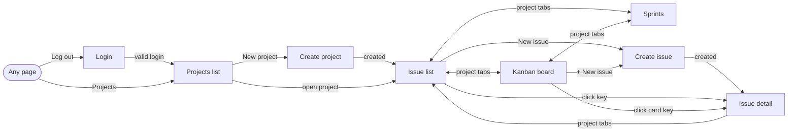

# UI Design

This document describes the screens of the Jira clone MVP and records the low-fidelity wireframe of its main screen, the **Kanban board**. Behaviour is owned by the specs in [`specs/`](../../specs); the web conventions are in [`architecture.md`](../architecture.md).

**Wireframe:** [`board-wireframe.html`](./board-wireframe.html). Open it in a browser; no server is needed. Cards can be dragged to try the interaction; nothing is saved.

**How it was made:** generated with an AI coding assistant (Claude, in OpenCode) from the specs, then checked against them (section 4).

## 1. Visual direction

| Aspect | Choice |
| --- | --- |
| Toolkit | Bootstrap 5 from CDN, default theme; no custom design system |
| Wireframe style | Greyscale, dashed boxes, handwritten-style font, yellow notes for behaviour |
| Layout | Global navbar, then a project header with project tabs, then the page content |
| Interaction | Links and forms work as plain HTML; htmx swaps fragments; SortableJS only on the board |
| Text | Plain text only; user content is always escaped |

## 2. Screens

| Screen | URL | Spec | MR |
| --- | --- | --- | --- |
| Login | `/login` | AUTH | 1 |
| Projects list and create | `/projects`, `/projects/new` | PRJ | 2 |
| Issue list (filters, search, paging) | `/projects/{key}/issues` | ISS | 3–4 |
| Create issue | `/projects/{key}/issues/new` | ISS | 3 |
| Issue detail (inline edit, comments, history, sprint) | `/projects/{key}/issues/{n}` | ISS, CMT, HST, SPR | 3, 5, 7, 8, 10 |
| **Kanban board** (wireframed) | `/projects/{key}/board` | BRD, SPR | 6, 10 |
| Sprints | `/projects/{key}/sprints` | SPR | 9 |

## 3. Navigation map



## 4. Board wireframe

### Layout

```text
+--------------------------------------------------------------------+
| [Jira Clone]  Projects                          Alice Smith [Log out]|  1 navbar
+--------------------------------------------------------------------+
| PROJ — Demo project   (Issues) [Board] (Sprints)      [+ New issue]|  2 project header
+--------------------------------------------------------------------+
| Sprint: [Sprint 3 (active) v]                                      |  3 sprint filter
+----------------------+----------------------+----------------------+
| TO DO (2)            | IN PROGRESS (1)      | DONE (0)             |  4 columns
| +------------------+ | +------------------+ |                      |
| | PROJ-3 Write ... | | | PROJ-5 Add ...   | |   (empty column      |
| | STORY LOW  Unass.| | | TASK MEDIUM Alice| |    still shown)      |
| +------------------+ | +------------------+ |                      |
| | PROJ-8 Login ... | |                      |                      |
| | BUG HIGH     Bob | |                      |                      |
| +------------------+ |                      |                      |
+----------------------+----------------------+----------------------+
```

### Validation against the MVP

Every element on the wireframe maps to a spec requirement, and every user-visible board requirement appears on the wireframe.

| # | Element | Behaviour | Requirement |
| --- | --- | --- | --- |
| 1 | Navbar: Projects link | Back to all projects (every user sees every project) | PRJ-2 |
| 1 | Navbar: user name, Log out | Logout is a `POST` with CSRF; then the login page | AUTH-5, AUTH-6 |
| 2 | Project tabs Issues, Board, Sprints | Move between the project's screens | ISS-9, BRD-1, SPR-17 |
| 2 | + New issue | Opens the create form | ISS-1 |
| 3 | Sprint selector: All, a sprint, No sprint | Filters the board; invalid values return `422` | SPR-15, SPR-16 |
| 4 | Three fixed columns in order | To Do, In Progress, Done; counts per column | BRD-1 |
| 4 | Empty Done column | Empty columns are still shown | BRD-2 |
| 4 | Card order by number | PROJ-3 above PROJ-8 | BRD-3 |
| 4 | Card content | Key, title, type, priority, assignee or "Unassigned"; key links to detail | Board spec "Card content" note |
| 4 | Drag and drop | Changes status only; a failed move snaps back; the move is in history | BRD-4, BRD-6, BRD-9 |

### Not on the wireframe, on purpose

These are out of scope in the specs, so the wireframe does not show them: search or other filters on the board, swimlanes, WIP limits, manual ordering inside a column, avatars, notifications, live updates from other users, settings or admin menus.

### Findings from the review

| # | Finding | Decision |
| --- | --- | --- |
| F-1 | The card count per column header is not in the board spec | Kept as a presentation detail; no behaviour depends on it. Remove if unwanted |
| F-2 | The sprint selector exists only from MR 10; before that the board shows all issues | The board renders without the selector until then |
| F-3 | "+ New issue" on the board is not in the board spec; it links to the issues create page | Kept as a shortcut to an existing screen; no new behaviour |
| F-4 | Without JavaScript the board still renders and links work, but drag-and-drop does not | Accepted for the MVP; status can still be changed from the issue detail page |
